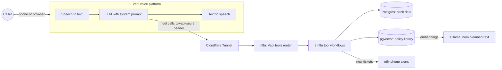

# Nova Bank Voice Agent

An AI phone agent for a fictional bank. Callers dial a real phone number and speak to an assistant that verifies their identity, answers policy questions, looks up balances and transactions, blocks stolen cards, orders replacements, opens disputes, and hands cases to a human, all against a realistic database.

**All data is fake.** Nova Bank, its customers, and their money were generated for this project.

## Demo calls

- 🎧 [**Fraud call**](https://drive.google.com/file/d/1s469B-CWYZwFo-L3iiN0X8EIkBjwAHxJ/view?usp=sharing): a caller reports charges they don't recognize. The agent verifies them, identifies the foreign charges, blocks the card that was used, opens an urgent fraud ticket, and orders a replacement with free express delivery (about 3.5 minutes).
- 🎧 [**Charged twice**](https://drive.google.com/file/d/1VMHKm1l1VI4ZEExZrzK3QLRLkvnTShWi/view?usp=sharing): an unscripted call. The agent finds the one real duplicate among five charges at the same store, answers follow-up questions from the policy library, says honestly when it doesn't know something, and opens a dispute (about 4 minutes).

## What a call looks like

> **Caller:** I see charges on my account that I don't recognize.
>
> **Agent:** I can help with that. First, please say your 5-digit customer ID, one digit at a time.
>
> *(verifies the caller, finds the transactions)*
>
> **Agent:** I found a charge at Electro Mart in Lagos, Nigeria for six hundred five dollars and thirty-three cents, and two from Globaltech Trading in Hong Kong. Which of these don't you recognize?
>
> **Caller:** The ones from Nigeria and Hong Kong weren't me.
>
> **Agent:** Just to confirm, you want me to block your debit card ending 6682? Once blocked, it can't be used again.
>
> *(blocks the card, creates an urgent fraud ticket, orders a replacement with free express delivery)*

## Architecture



| Layer | Technology | Role |
|---|---|---|
| Voice | Vapi | Phone number, speech-to-text, text-to-speech, turn-taking, keypad input |
| Brain | OpenAI mini model (via Vapi) | Conversation and tool choice, guided by the system prompt |
| Automation | n8n (self-hosted, Docker) | A router plus one workflow per tool |
| Data | Postgres | Customers, accounts, cards, transactions, loans, transfers, tickets, disputes |
| Knowledge | pgvector + Ollama | 14 policy documents, searched by meaning (RAG) |
| Access | Cloudflare Tunnel | Exposes the local n8n to Vapi |
| Alerts | ntfy | Push notifications for new tickets |

## The tools

| Tool | Reads or changes | What it does |
|---|---|---|
| `verify_identity` | reads | Checks customer ID + security answer. Counts failures per call and locks after three. |
| `search_policies` | reads | Semantic search over the policy library, with a relevance cutoff |
| `get_account_overview` | reads | Balances, account status, cards, loans, recent transfers, open tickets |
| `get_transactions` | reads | Filtered transactions, totals, duplicate-charge detection, which card was used |
| `block_card` | changes | Blocks a card after explicit confirmation |
| `request_replacement_card` | changes | Orders a new card, with fees and business-day delivery dates |
| `dispute_transaction` | changes | Opens a dispute, enforcing the bank's dispute rules |
| `create_ticket` | changes | Hands off to a human, decides priority, alerts by phone |

## Design principles

**The AI talks; n8n decides.** Anything that must be exact is done in code, not by the model:

- **Math and money:** totals, available credit, fees, and amounts spelled out in words (models misread long numbers)
- **Rules:** dispute eligibility (card payments only, posted, within 60 days), replacement fees (express is free after fraud), ticket priority and response times
- **Dates:** delivery dates and dispute deadlines, skipping weekends
- **Detection:** duplicate charges (same account, merchant, and amount within 10 minutes)

**Safety enforced in code, not just in the prompt:**

- Every account tool **re-verifies** the ID and security answer inside its own SQL query, so a tool called by mistake returns nothing
- Actions require `confirmed: yes`; without it the tool only describes what it *would* do and gives the agent the exact question to ask
- Actions only apply to valid states (you can't block an already blocked card or dispute a pending charge)
- **Verification lockout:** three failed attempts per call (tracked by call ID) locks verification, even for a later correct answer
- IDs with the wrong number of digits are rejected without counting as a failed attempt
- Full card numbers are cut to the last 4 digits before anything touches the database
- All SQL uses parameterized queries (no SQL injection)
- Every change is recorded (`card_actions`, `disputes`, `tickets` with a `source` column)
- The router rejects requests without the shared secret header

**Never leave a gap for the model to fill.** Every tool always returns a clear result, including "NOT VERIFIED", "NO POLICY FOUND", or "NO MATCHING CARD", plus instructions for what to say next.

## Testing and what it revealed

Testing ran in three layers, cheapest first:

1. **Direct workflow tests** in n8n with mock inputs (free)
2. **Router tests with curl**, simulating Vapi's requests (free)
3. **A text-chat version of the agent** in n8n using the same prompt and tools (free)
4. **Voice calls** through Vapi, scripted and then with a real person

Real problems found and fixed along the way (details in [docs/testing.md](docs/testing.md)):

| Problem | Fix |
|---|---|
| The prompt described tools that didn't exist yet, so the model looped trying to call them | The prompt lists only real tools |
| The agent kept asking for verification forever after wrong answers | Attempts counted in the database, locked after three |
| "Yep" was taken as a security answer | ID confirmation and security answer asked as separate questions |
| Fraud blocked the wrong card (the only active one, not the one used) | Transactions report which card made each payment |
| A "yes" to one action was used to perform a different one | Each action requires its own question and its own yes |
| The model misread balances (".19" instead of ".94") | Tools give amounts in words first |
| Speech-to-text grouped and dropped digits | Digit-joining rule, length check in code, keypad entry |
| **Real-user test:** a misheard answer was reused for every retry, locking out the caller | Always re-ask the security answer after a failure |
| **Real-user test:** fake office background noise confused the caller | Background sound turned off |

## Repository layout

```
.
├── README.md
├── docker-compose.yml        # n8n + Postgres (pgvector)
├── nova-bank/
│   ├── schema.sql            # database design
│   ├── generate_data.py      # creates ~500 fake customers and ~100k transactions
│   └── reset_tests.sh        # undoes changes made during testing
├── knowledge-base/           # 14 policy documents (the RAG library)
├── prompts/
│   └── system-prompt.md      # the agent's system prompt
├── vapi/tools/               # tool definitions for Vapi
├── workflows/                # exported n8n workflows (sanitized)
├── scripts/
│   └── sanitize_workflows.py # removes private values from n8n exports
└── docs/
    └── testing.md            # test plan and findings
```

## Running it locally

Requirements: Docker, Python 3, Ollama, cloudflared, and a Vapi account.

```bash
# 1. Start n8n and Postgres
docker compose up -d

# 2. Create the fake bank
cd nova-bank
python3 -m venv .venv && source .venv/bin/activate
pip install faker "psycopg[binary]"
python generate_data.py

# 3. Embedding model for the policy library
ollama pull nomic-embed-text

# 4. Expose n8n to Vapi
cloudflared tunnel --url http://localhost:5678
```

Then in n8n: import the files in `workflows/`, create the Postgres, Ollama, and header-auth credentials, run **KB - Load policies** once, and publish the tool workflows and the router. In Vapi: create the tools from `vapi/tools/`, paste `prompts/system-prompt.md` as the system prompt, and set the assistant's server URL to `https://<your-tunnel>/webhook/vapi-tools` with the `x-vapi-secret` header.

## Limitations

- The free Cloudflare quick tunnel changes address on every restart, so the Vapi server URL must be updated each time
- The verification lockout lives in `verify_identity`; other tools re-verify but don't check the lock
- Speech-to-text still occasionally mishears digits and single-word answers; keypad entry is the reliable path on phone calls
- This is a learning project with fake data, not a production banking system (no real authentication, compliance, or encryption at rest)

## Next steps

- Post-call summaries saved to `call_log`, with alerts for urgent calls
- A permanent tunnel with a fixed domain
- An outbound sales agent that reuses the same tool architecture
